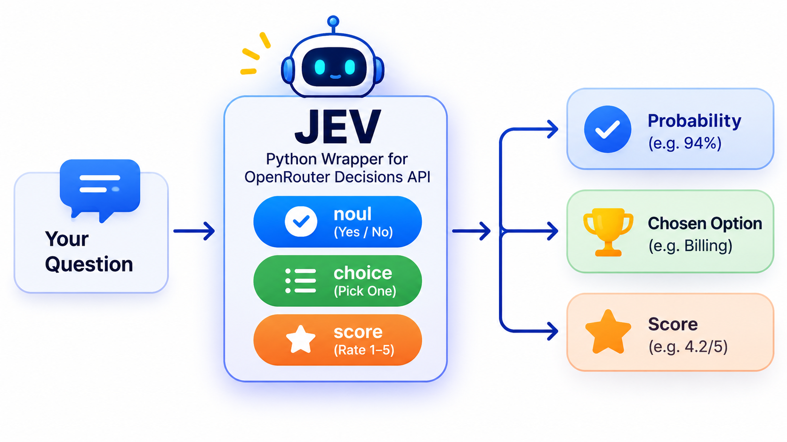

# JEV-PYTHON

<p align="center">
  
</p>

A Python sandbox for the [OpenRouter **Decisions** API](https://openrouter.ai/api/alpha/decisions) (`parallel/decisions-fast:free`).

Instead of free-form chat completions, the Decisions API answers **structured questions** about a `state` (some text you provide) and returns **typed, machine-readable answers** — probabilities, choices, and scores with confidence values. `jev.py` is a thin wrapper (`ask()`) around that endpoint; the numbered files are standalone examples, one per decision type.

## Decision types

All three decision types supported by the API are implemented:

| Type | What it answers | Answer shape | Example file |
|---|---|---|---|
| `noul` | Binary yes/no decision, returned as a probability (0–1) | `["is_refund"]["noul"]` → e.g. `0.94` | `01_test_call.py`, `03_noul.py` |
| `choice` | Picks ONE option from a list you define | `["team"]["choice"]` + `["confidence"]` | `02_choice.py` |
| `score` | Numeric rating on a scale you define (1–5) | `["candidate_score"]["score"]` + `["legend"]` + `["confidence"]` | `04_score.py` |

### 1. `noul` — yes/no probabilistic decision
Ask whether something is true, get back a probability, then branch on a threshold (`> 0.5` → refund team, else → normal queue).
Used for: intent detection, gating, classification into exactly two buckets.

### 2. `choice` — single-select classification
Define the options and what each means in `criteria`; the API returns which option fits best plus a confidence.
Used for: routing (which support team?), category tagging, picking one of N known actions.

### 3. `score` — numeric rating with a legend
Define a scale and a rubric; the API returns a float score, a `legend` mapping each level to a label, and a confidence.
Used for: quality/fit ratings (candidate evaluation), prioritization, grading.

## Project structure

```
jev.py             # shared client: ask(state, question) -> data["answers"]
01_test_call.py    # raw requests.post — noul type, inline (no jev.py import)
02_choice.py       # choice type — route 5 support messages to teams
03_noul.py         # noul type — refund detection over 8 messages
04_score.py        # score type — score 5 candidates for a Python backend role
pyproject.toml     # uv project metadata + dependencies
.env               # OPENROUTER_API_KEY + MODEL (not committed — see setup)
```

## Setup

Requirements: **Python 3.13+** and [uv](https://docs.astral.sh/uv/) (it can also install Python for you).

```powershell
# 1. Get an API key from https://openrouter.ai/keys  (must allow the free model)

# 2. Install dependencies (creates .venv automatically)
uv sync

# 3. Create a .env file in the project root:
#    OPENROUTER_API_KEY=sk-or-v1-...
#    MODEL=parallel/decisions-fast:free

# 4. Run the examples
uv run 01_test_call.py   # raw call + threshold routing
uv run 03_noul.py        # yes/no decisions
uv run 02_choice.py      # option picking / routing
uv run 04_score.py       # 1-5 scoring
```

Or without installing uv: create a venv with Python 3.13+, `pip install python-dotenv requests`, and run `python 02_choice.py` etc. directly.

## How a question is structured

Every question is a dict entry — a name, a `type`, `instructions`, and `criteria` (modeled per type):

```python
question = {
    "team": {                                # your key for the answer
        "type": "choice",                    # noul | choice | score
        "instructions": "Which team should handle this message?",
        "criteria": {
            "shipping": "Deliveries, tracking, lost packages",
            "billing":  "Charges, refunds, invoices",
        },
    }
}

answers = ask(state="I was charged twice...", question=question)
# answers["team"] -> choice, confidence
```

`criteria` changes shape per type: for `noul` it's `{"true": ..., "false": ...}`, for `choice` a `{option: description}` map, and for `score` a list of level descriptions (1 = first entry, 5 = last).

## Notes

- [ ] The Decisions API is an **alpha** endpoint (`/api/alpha/decisions`) — response shape may change.
- [ ] The free model (`parallel/decisions-fast:free`) has rate limits; add error handling / backoff for batch runs.
- [ ] `jev.py` debug: uncomment the `print(json.dumps(data, indent=2))` line to see the full raw response.
- [ ] Make sure `.env` stays out of git and out of GitHub — rotate any key that was ever committed.
